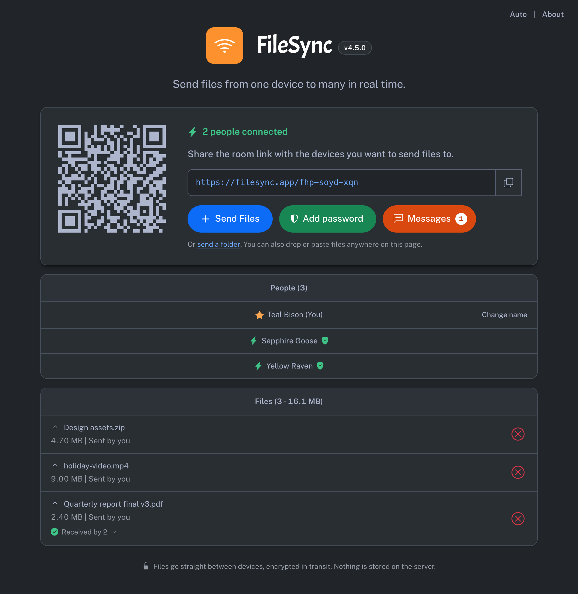
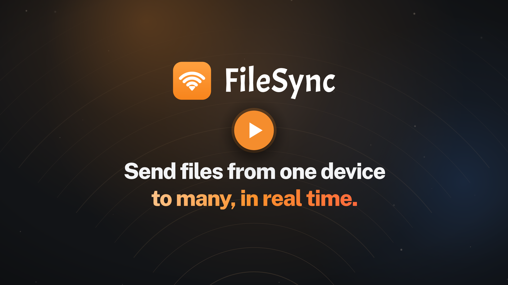

<div align="center">

<h1 align="center">FileSync</h1>

**Send files from one device to many, in real time: private, peer-to-peer, with no size limit.**

<p align="center">
<a href="https://github.com/polius/filesync/actions/workflows/release.yml"></a>&nbsp;<a href="https://github.com/polius/filesync/releases"></a>&nbsp;<a href="https://hub.docker.com/r/poliuscorp/filesync"></a>&nbsp;<a href="LICENSE"></a>
</p>

<br>



</div>

## Features

- **Private**: files go directly between browsers over WebRTC, encrypted in transit. The server only introduces devices to each other and never sees file contents.
- **Verified links**: shared links carry a security key in the part after `#`, which browsers never send to any server. Joining with it proves nobody, not even the server, sits between you and the host.
- **Any file size**: files stream to disk as they arrive, with flow control so memory stays bounded even when the disk is slower than the network.
- **Checked on arrival**: every file is verified with SHA-256 when it lands.
- **Automatic resume**: interrupted transfers reconnect and continue from the last byte saved.
- **One-to-many**: share a link or QR code; everyone in the room can send and receive. Download everything as one zip.
- **Folders, paste and messages**: send whole folders (paths are kept in the zip), paste files from the clipboard, and send links or notes to the room.
- **Works across networks**: direct connection when possible, automatic relay when not.
- **No installs or accounts**: recipients just open a link. Rooms can have a password.
- **Self-hosted**: a single Docker image plus a TURN relay, both started with one command.

## How it works

<p align="center">
  <a href="https://filesync.app/video.mp4">
    
  </a>
</p>

<p align="center"><em>One minute: opening a room, sharing the link, sending files browser to browser,
verified links, and resuming large transfers. Plays as an MP4 in your browser.</em></p>

## Self-hosting

### Prerequisites

- [Docker](https://docs.docker.com/get-docker/) with [Docker Compose](https://docs.docker.com/compose/install/)

### Option A — HTTP (quick local test)

For trying FileSync on your own machine. Not for production; use [Option B](#option-b--https-own-domain-recommended) instead. Over plain HTTP, received files are held in memory until complete (over HTTPS they stream to disk), so large files need Option B.

1. Download [`deploy/docker-compose.yml`](deploy/docker-compose.yml).
2. Start it:

```bash
docker compose up -d
```

Open `http://localhost` on the machine running Docker.

### Option B — HTTPS (own domain, recommended)

1. Download [`deploy/docker-compose-ssl.yml`](deploy/docker-compose-ssl.yml) and [`deploy/Caddyfile`](deploy/Caddyfile).
2. Open `Caddyfile` and replace `yourdomain.com` (the first line) with your domain.
3. Point your domain's DNS at the server, then start it:

```bash
docker compose -f docker-compose-ssl.yml up -d
```

Open `https://yourdomain.com`. Caddy gets a certificate automatically and redirects `http://` to `https://`.

The signing secret for TURN credentials is generated on first start and kept in a Docker volume. You don't need to set anything.

## Required ports

Open these on your server's firewall:

| Port | Protocol | Purpose |
|---|---|---|
| `80` and `443` | TCP | Web interface (`80` only redirects to HTTPS in Option B) |
| `3478` | TCP + UDP | STUN/TURN: finding the best connection between devices |
| `50000–50100` | UDP | TURN relay range, used when a direct connection isn't possible |

Most transfers connect directly. The relay range carries traffic only when one side is behind a strict firewall or symmetric NAT. Each pair of devices uses at most one relay port, so the default range serves about 100 relayed pairs at once.

If something doesn't work on a device, open `/test.html` on it for a diagnostic report.

## Configuration (optional)

Set these as `environment:` entries on the `filesync` service.

| Variable | Default | Purpose |
|---|---|---|
| `TURN_HOST` | the address users open | Hostname or IP of the TURN server, if it differs from the website's |
| `TURN_PORT` | `3478` | TURN/STUN port advertised to browsers |
| `TURN_EXTERNAL_IP` | unset | Public IP of the TURN server. Set it when the website sits behind a CDN or proxy whose address isn't the TURN server's |
| `FILESYNC_TURN_TTL_SECONDS` | `3600` | Lifetime of TURN credentials (browsers refresh them automatically) |
| `FILESYNC_CLAIM_GRACE_SECONDS` | `120` | How long a room stays reserved after its host disconnects, so a reload keeps the same link |
| `FILESYNC_MAX_WS` | `10000` | Maximum simultaneous signaling connections |
| `FILESYNC_EXPOSE_STATS` | unset | Set to `1` to include connection counts in `/api/health` |

**Custom HTTP port.** In `docker-compose.yml`, change the first number of the `filesync` port mapping, for example `"8080:80"`.

## Related projects

If you prefer the terminal, check out [fsend](https://github.com/polius/fsend): fast, private file sharing from your command line.

## License

Released under the [MIT License](LICENSE). Third-party components and their licenses are listed in [THIRD_PARTY_NOTICES.md](THIRD_PARTY_NOTICES.md).

<br>


*Comic: [xkcd #949 — "File Transfer"](https://xkcd.com/949) by [Randall Munroe](https://xkcd.com), licensed under [CC BY-NC 2.5](https://creativecommons.org/licenses/by-nc/2.5/).*
